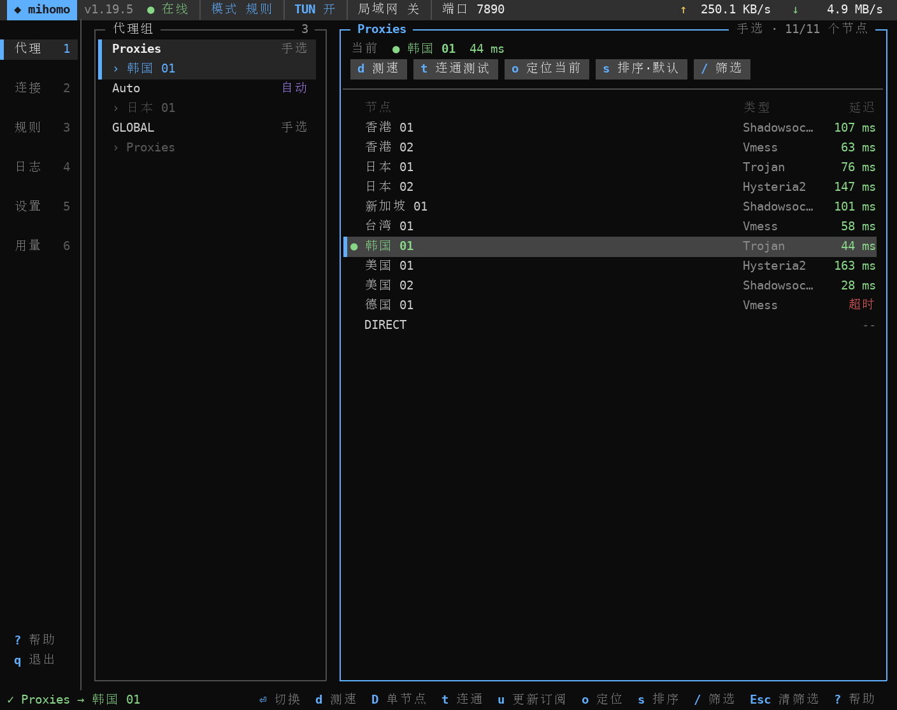
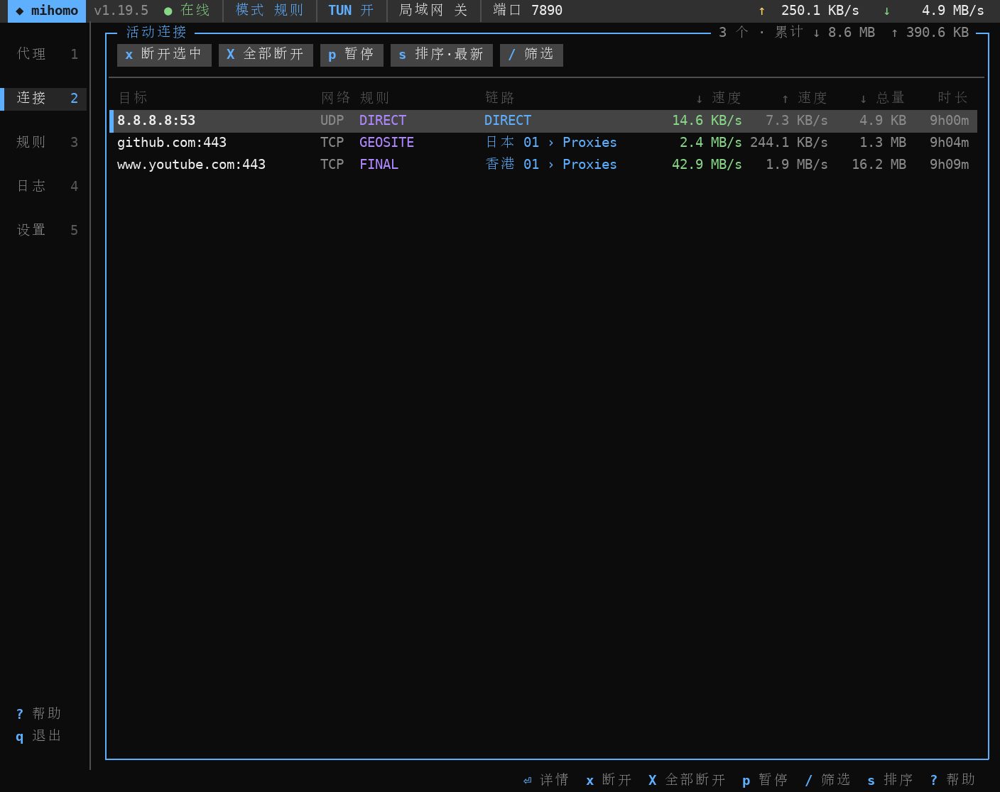
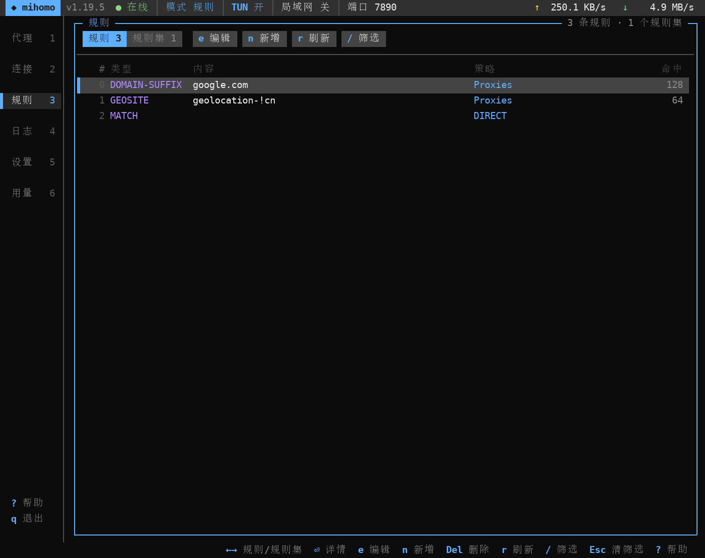
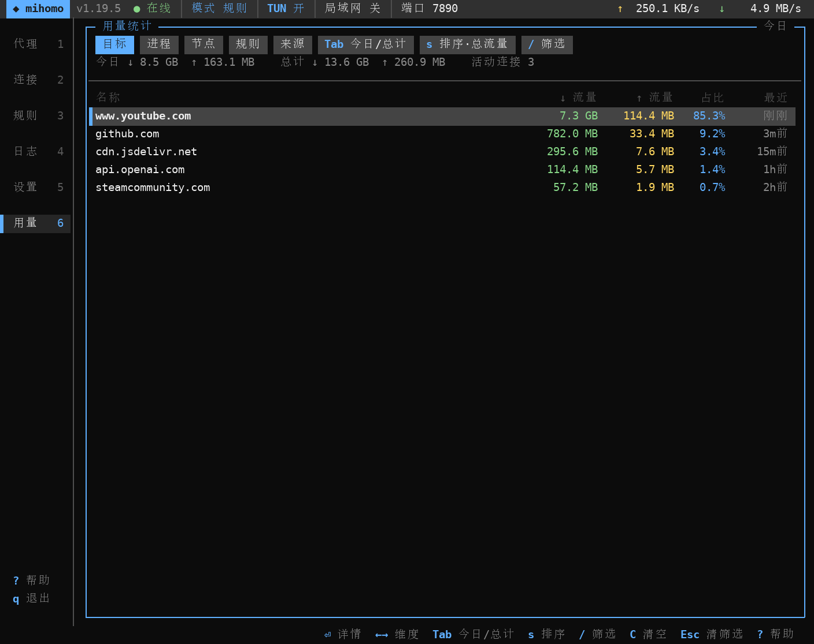
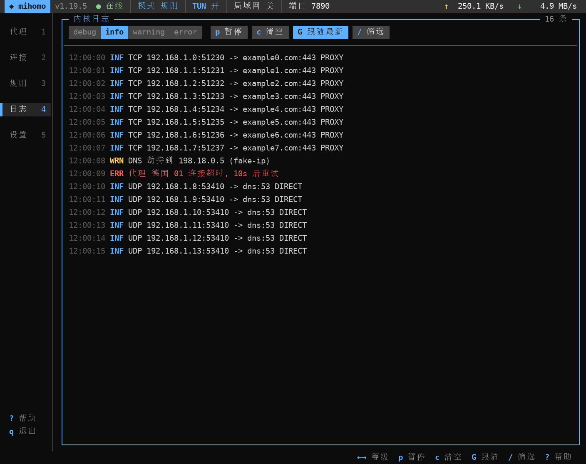
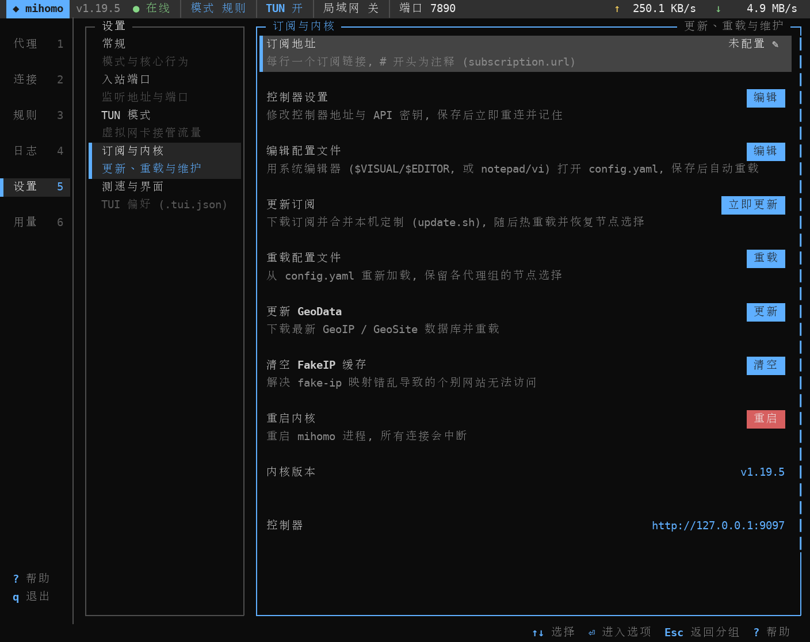

# clashtop

mihomo 控制台 TUI —— Clash Verge 的轻量终端平替。**纯标准库单文件脚本, 零必装依赖**,
键盘 + 鼠标完整可用, 支持 Windows 命名管道控制器 (适配 Clash Verge)。



| 连接 | 规则 | 用量 |
|:-:|:-:|:-:|
|  |  |  |
| **日志** | **设置** | |
|  |  | |

| 文件 | 说明 |
|---|---|
| `tui.py` | 主程序, 跨平台 (Windows / Linux / macOS), **唯一源码** |
| `tui-win.py` | Windows 专用版, 由 `_gen_tuiwin.py` 从 `tui.py` 生成, 可独立分发 |
| `_gen_tuiwin.py` | 生成器, 见下文「开发」 |
| `shot.py` | 自动化截图 (dev-only, 需 Pillow): 内置假 mihomo 服务 + 无头驱动 + PNG 渲染 |

## 运行要求

- Python ≥ 3.8, **无需安装任何依赖** (Windows 也不需要 windows-curses)
- 可选: `pip install pyyaml` —— 仅用于「修改写回 config.yaml」功能, 缺失时其余功能不受影响
- POSIX 鼠标需终端支持 SGR(1006) 协议 (xterm / Windows Terminal / tmux 等均支持);
  不支持时鼠标无效, 键盘照常

## 快速开始

```bash
python tui.py                 # 任意平台
python tui-win.py             # Windows (独立分发版, 等价)
```

也可以把 `tui.py` 软链接到内核配置目录后运行: `config.yaml` / `.tui.json` /
`.usage.json` / `update.sh` 等运行文件会跟随软链接所在目录 (`HERE` 不解析软链)。

不带参数即可: 启动时自动探测控制器 —— 上次成功的连接 → Clash Verge / Mihomo Party
等前端与内核配置里的 `external-controller` / `secret` → Windows 命名管道 →
常见端口 9097/9090。需要密钥而配置里没有时, 启动时提示输入并记住。

```
用法: tui.py [-a ADDR | --host HOST -p PORT] [-s KEY] [--managed] [代理组名]

  -a, --api ADDR   控制器地址 http://127.0.0.1:9097, 或 pipe:管道名 / pipe:auto
  --host HOST      控制器主机 (默认 127.0.0.1)
  -p, --port PORT  控制器端口 (默认 9097)
  -s, --secret KEY API 密钥
  --managed        托管模式 (后台拉起本地内核, 需自备二进制)
  --core PATH      内核二进制路径 (仅托管模式)
  --workdir DIR    工作目录 (默认脚本/软链所在目录; 影响 config.yaml 与 mihomo.log)
  --config PATH    配置文件路径 (默认 <workdir>/config.yaml); 用于控制器探测与托管模式
  代理组名          启动时选中的代理组 (默认自动选择)

环境变量: MIHOMO_API  MIHOMO_HOST  MIHOMO_PORT  MIHOMO_SECRET
  CLASHTOP_MANAGED / MIHOMO_MANAGED (=1 开托管)  MIHOMO_CORE
  CLASHTOP_WORKDIR / MIHOMO_WORKDIR  MIHOMO_CONFIG
```

`pipe:auto` 自动枚举 `\\.\pipe\` 下 `verge-mihomo-*` / `*mihomo*` 命名管道。

## 运行模式

- **仅管理模式（默认）**：只连接已在运行的内核（Clash Verge / Mihomo Party / 手动启动的
  mihomo），不拉起进程、不下载任何东西，也**不会创建 config.yaml**。找不到配置或控制器时，
  启动提示会建议用 `--config` 指定配置、用 `-a/-p/-s` 直接指定控制器与密钥，或改用托管模式。
  离线页每 3 秒自动重试，也可点「改用托管模式」(`s`) 当场切换（需自备二进制）。
- **托管模式（`--managed` / `CLASHTOP_MANAGED=1`）**：后台拉起本地 mihomo 进程并常驻
  （退出 TUI 不杀进程，日志落到工作目录 `mihomo.log`）：

```bash
python tui.py --managed                 # 二进制已存在则直接拉起
python tui.py --managed --core ./mihomo # 指定内核路径（或 MIHOMO_CORE）
python tui.py --managed --workdir DIR   # 指定工作目录（配置与日志落在此处）
```

托管模式行为：需自备 mihomo 二进制（放 `PATH` / 脚本目录 / 工作目录，或
`--core` / `MIHOMO_CORE` 指定；本工具不提供内核下载）；缺 `config.yaml`
时生成最小可用配置（含 `external-controller: 127.0.0.1:9097`）；既有配置缺
该项时自动补一行；`u` 更新订阅在没有 `update.sh` 时走内置下载
（`subscription.url`，完整配置则备份替换 `config.yaml` 并重载）；
`R` 重启失败时自动改走拉起。

## 界面

左侧导航或数字键 `1`-`6` 切换页面:

| 页 | 功能 |
|---|---|
| 1 代理 | 代理组/节点选择 (单击即切换)、批量/单点测速、排序、筛选、经代理连通测试 |
| 2 连接 | 实时连接列表与速度、断开选中/全部、查看详情 |
| 3 规则 | 规则与规则集, 表单新增/编辑规则、删除并热重载, 规则集详情中可更新远程规则集 |
| 4 日志 | 内核实时日志, 等级切换 / 暂停 / 清空 / 跟随最新 |
| 5 设置 | 常规 / 入站端口 / TUN / 订阅与内核 / 测速与界面; 订阅地址、控制器地址/密钥可直接编辑, 配置文件可用系统编辑器打开 |
| 6 用量 | 按目标 / 进程 / 节点 / 规则 / 来源统计今日与累计流量, 可排序、筛选、清空 |

常用键: `↑↓/jk` 移动 · `←→/hl` 切换焦点 · `⏎` 确认 · `Esc` 返回 · `/` 筛选 · `?` 帮助 · `q` 退出

全局键: `c` 连接页 · `m` 切换模式 · `T` TUN 开关 · `a` 局域网共享 · `u` 更新订阅 · `R` 重启内核 · `t` 连通测试 · `r` 刷新

鼠标: 单击导航/代理组/节点/按钮/开关/分段选项即生效, 滚轮滚动列表。

## 会读写的文件

默认位于脚本（或 `tui.py` 软链接）所在目录 (`--workdir` / `--config` 可改 config.yaml 与 mihomo.log 的位置):

- `config.yaml` — mihomo 内核配置; 开启「修改写回配置文件」后, 运行时修改会合并写回
  (需 PyYAML; 原子替换写入); 设置页可用系统编辑器直接编辑并热重载
- `config.yaml.bak` — 内置订阅下载替换完整配置前自动备份
- `subscription.url` — 订阅地址, `u` 更新订阅时读取 (可多行, `#` 注释; 设置页可直接编辑)
- `subscription.yaml` — 内置下载的非完整配置片段落在此处, 需在 `config.yaml` 中引用
- `update.sh` / `update.bat` / `update.cmd` / `update.ps1` — 订阅更新脚本, 按序探测执行
  (有脚本时优先用脚本, 托管模式无脚本才走内置下载)
- `mihomo.log` — 托管模式拉起的内核日志 (工作目录下)
- `.tui.json` — 界面偏好 (测速地址/超时/并发、日志等级等) 与上次成功的控制器连接缓存
- `.usage.json` — 用量统计 (今日/总计, 按目标/进程/节点/规则/来源归因; 关闭时自动保存)

## 开发

**只改 `tui.py`**。它是唯一源码; `tui-win.py` 是生成产物:

```bash
python _gen_tuiwin.py        # 重新生成 tui-win.py
```

生成器删除 `tui.py` 中 `# >>> posix >>>` … `# <<< posix <<<` 标记的 POSIX 专属代码
(两处: 导入块、终端层), 再换 docstring 与程序名。**新增 POSIX-only 代码时必须包进
该标记块**, 否则会泄漏进 tui-win.py (生成器对标记段数量有断言)。

### tui.py 内部分层 (按 `# ─── xxx ───` 分节)

| 节 | 内容 |
|---|---|
| 数据层 | `api()` REST 封装、偏好读写、订阅脚本选择、写回 `config.yaml` |
| 托管模式 | 内核查找、配置补齐、订阅下载、后台拉起 |
| 命名管道 / 控制器探测 | Windows 命名管道传输 (`pipe:`)、`external-controller` 自动探测 |
| 文本宽度 | `cw/tw/clip/wrap` —— CJK 宽字符与组合字符处理 |
| 绘制基础 | 终端层 `Term` (基类 `_TermBase` 帧缓冲 + `_WinTerm`/`_PosixTerm`)、`Theme`、`Hits`、`Canvas`、`ListView` |
| 弹窗 | `Modal` 及 Confirm/Input/Select/Info 弹窗 |
| 页面 | 六个 `Page` 子类 |
| 应用 | `App` 主循环、按键分发、`main()` |

终端抽象接口: `erase()` 清帧缓冲 → `Canvas` 写入 → `refresh()` 逐格对比上帧只重写变化行;
`read(ms)` 返回事件列表 —— 键名字符串、`("press"/"dbl"/"wheel", x, y[, up])` 鼠标元组、
`"resize"`。Windows 走 `ReadConsoleInputW`, POSIX 走 `termios`+select 解析 VT 序列,
SGR 鼠标由 `_seq_event()` 解析。

### 验证

无测试套件。最低验证:

```bash
python -m py_compile tui.py && python _gen_tuiwin.py && python -m py_compile tui-win.py
python tui.py --help
```

`docs/screenshot1~6.png` 用 `python shot.py` 重抓 (假服务 + 确定性数据, 两次运行逐字节一致);
`python shot.py offline confirm help` 抓附加状态到 `docs/shots/`。

POSIX 输入解析可在任意平台单测 (`_seq_event` / `_PosixTerm._keys` 不依赖 termios 即可调用,
它们只是被注释标记圈起来、运行时才经 `else` 导入)。

### mihomo API 使用面

REST: `GET /version` `GET/PATCH /configs` `PUT /configs?force=true` `POST /restart`
`GET/PUT /proxies/{name}` `GET /proxies/{name}/delay` `GET/DELETE /connections`
`GET /rules` `GET/PUT /providers/rules` `POST /configs/geo` `POST /cache/fakeip/flush`;
流式: `/logs?level=` `/traffic` (命名管道下由 `PipeReader` 解 chunked)。
用量统计每 3 秒采样一次 `GET /connections`, 按连接累计字节的增量归因并落盘到 `.usage.json`;
「进程」维度依赖内核的 `find-process-mode` 配置。

## License

MIT — 见 [LICENSE](LICENSE)。
